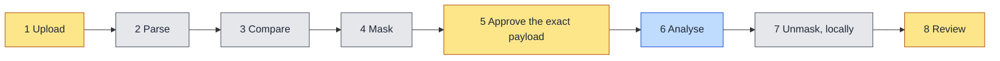

# EDI Copilot

**A compliance check on data the AI never sees. Up to 50 minutes by hand, 8 minutes with the system.**

This repo is the case study. The code belongs to a client and stays private. The full story is on my site: [arunbhisne.com/projects/edi-copilot](https://www.arunbhisne.com/projects/edi-copilot)

| | |
|---|---|
| **The job** | Checking a partner's invoice file against a retailer's rulebook, line by line. A rulebook can run to 200 pages. |
| **The team** | Seventy analysts, five or six files a day each |
| **My role** | Every architecture, redaction, evaluation and product decision. AI coding agents wrote the code. |
| **Today** | A live pilot on a deployed server |

The files carry names and account numbers the company is contractually bound to protect. That is why nobody could use AI on them. Too slow to do by hand. Too sensitive to hand to AI.

## What changed

| | By hand | With the system |
|---|---|---|
| One document | 30 to 50 minutes | 8 minutes |
| Confidential data | AI kept out entirely | 2,375 values masked, 0 sent, across 7,724 differences |
| A pass verdict | The analyst's memory of a 200-page rulebook | A quoted passage, or no pass |
| Time handed back | | About 3,000 hours a year (projected) |

**How these were measured.** 30 to 50 minutes, seventy analysts and the 200-page rulebook are the client's own figures. 8 minutes, 7,724 differences and 2,375 masked values are measured. 3,000 hours a year is a projection on the client's own planning volume.

## How it works

Eight stages. Six of them never call a model. One is a person approving the exact payload before anything is sent.



*Yellow: a person. Grey: code, no model. Blue: the only stage that calls the model, with rows sent in batches of twenty.*

Every sensitive value becomes a token before the prompt is assembled, and it is restored locally against a mapping the model never sees. Here is one line of an EDI file, using a synthetic test value:

```text
On the host:        N1*ST*MEGA MART STORES
Sent to the model:  N1*ST*[PARTY_NAME_1]
Back on the host:   N1*ST*MEGA MART STORES
```

The qualifier (`ST`) carries no identity, so it stays readable and the model keeps the structure it needs. The name goes.

## Decisions I made

**1. I decided what the AI may never see, before I built anything.**
A leaked customer name here is not a bug. It is a breached contract. So I made exposure structurally impossible rather than unlikely.

**2. I mask by position, not by pattern.**
My first pass hid anything shaped like a code. "or" is Oregon and "in" is Indiana, so both vanished from the rulebook's own sentences, and the verdicts got worse. Now I mask by position in the record, never by how a string looks. Over-masking is not caution. It is a quieter way to be wrong.

**3. I attacked my own redaction, and the attack won.**
I handed my own redacted file to a stronger model and asked it to name the customer. It did, from a single product barcode. Barcodes are now caught by checksum arithmetic, not by how they look.

**4. Silence produces a refusal, not a guess.**
The dangerous verdict is a confident pass on a rule nobody checked. So a pass only stands if it quotes the passage that allows it, and code downgrades any pass it cannot verify.

| Verdict | Means |
|---|---|
| `valid_per_guidelines` | Explicitly allowed, and here is the passage |
| `no_action_required` | Structural or mechanical, settled without the model |
| `clarification_required` | A specific question would settle it |
| `reject` | The rulebook forbids this, and here is the passage |
| `needs_business_review` | The rulebook is silent, so a person decides. An uncited pass lands here. |

A downgrade only ever moves toward caution. Nothing moves up.

**5. I deleted the confidence score I had already shipped.**
Watching analysts work, a "medium" label changed nobody's behaviour. It sent them back into the rulebook anyway. So I removed it, along with two other controls. What replaced it is the receipt: the exact passage, the page it came from, the verbatim prompt and a fingerprint of what was sent.

## How I worked

I wrote none of the code. A planning model turns one decision at a time into a brief, a coding agent builds it, and then I audit the result as if a stranger wrote it. Across 12 briefs, that audit caught my own README claiming a safety feature that did not exist, and an audit trail whose fingerprint did not match what had been sent. Both are fixed.

## What this does not claim

- **No accuracy figure.** There is no answer key, so there is no precision or recall to quote.
- **One model stage, not one model call.** Rows go out in batches of twenty.
- **The leak scan is a check, not a guarantee.**
- **The pilot numbers are one snapshot.**

## About the code

The code belongs to the client, so it stays private. If you want to see how it was built, I'm happy to walk you through it on a call: the brief, the decisions and the checks.

---

**Arun Bhisne** · AI Solutions Designer-Builder · [arunbhisne.com](https://www.arunbhisne.com) · [LinkedIn](https://www.linkedin.com/in/arunbhisne)
